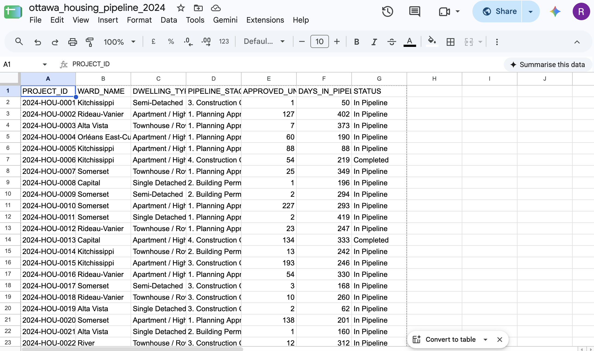
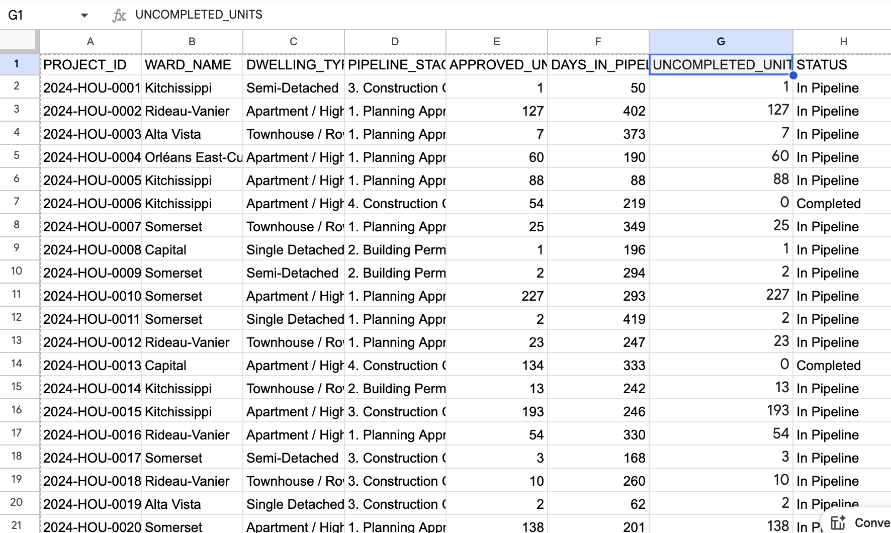
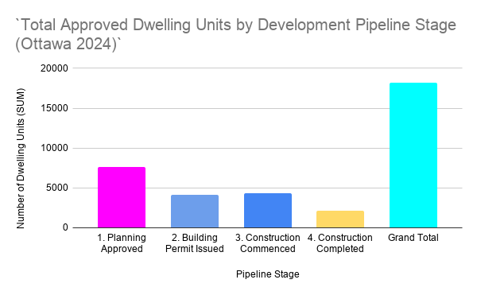

# Deliverable 2: Exploratory Data Analysis of Ottawa Housing Development Pipeline

**Date:** November 18, 2024  
**Course:** MPAD 2003: Introductory Data Storytelling  
**Student Name:** Ria Gandhi  
**Instructor:** Jean-Sébastien Marier  


## 1. Getting Data

This exploratory data analysis investigates administrative records from the City of Ottawa Housing Data Hub (2024) dataset, supplemented by Canada Mortgage and Housing Corporation (CMHC) housing construction benchmarks. The dataset tracks residential development proposals across Ottawa through four consecutive lifecycle stages: planning application approval, building permit issuance, construction commencement (housing starts), and final construction completion.

The raw data was accessed via the Open Ottawa Housing Data Hub portal. To analyze the records, I imported the dataset into Google Sheets using File > Import > Upload, setting character encoding to UTF-8 and delimiter settings to comma-separated values.

* Public Spreadsheet Link: https://docs.google.com/spreadsheets/d/1t_ed0XrftnDFWNFgSexk8WGgaqlS_EKZpuiYndzRnlg/edit?usp=sharing



The imported dataset contains 250 project rows and 7 core variables.
* Column A (PROJECT_ID): Represents nominal qualitative variables containing unique alphanumeric codes assigned to each housing proposal. No duplicate project identifiers were identified during initial validation.
* Column C (DWELLING_TYPE): Represents nominal categorical variables classifying building density (e.g., "Apartment / High-Rise", "Townhouse / Row", "Single Detached").
* Column D (PIPELINE_STAGE): Represents ordinal categorical variables tracking project progression ("1. Planning Approved", "2. Building Permit Issued", "3. Construction Commenced", "4. Construction Completed").
* Column E (APPROVED_UNITS): Represents quantitative discrete variables measuring the number of approved housing units associated with each permit application.

### Research Hypothesis

Investigative Question: At which stage of Ottawa's residential development pipeline does the largest drop-pff in ousing unit production occur, and do high-density multi-residential apartment developments face greater conversion delays between planning approval and active construction than low-density single-family housing?

## 2. Understanding Data

### 2.1. VIMO Analysis

To evaluate data quality and integrity prior to exploratory analysis, I performed a systematic VIMO analysis (Valid, Invalid, Missing, and Outlier data) focusing on development stages and unit counts (Statistics Canada, 2021).

| Category | Dataset Observations & Concrete Examples |
| :--- | :--- |
| 1. Valid Data | Standardized ward names (e.g., "Somerset", "Kitchissippi") and positive integer values in APPROVED_UNITS. |
| 2. Invalid Data | Inconsistent stage spacing and mixed text casing (e.g., "1. planning approved " vs "1. Planning Approved"). |
| 3. Missing Data | Blank completion timestamps for projects currently waiting at the planning approval or building permit stage. |
| 4. Outlier Data | High-density multi-residential projects approving 200+ units that remain in pre-construction for over 400 days. |

* Valid Data: Nominal ward identifiers and discrete unit counts conformed to standard municipal planning definitions established in the City of Ottawa Housing Approvals Dashboard (City of Ottawa, 2025).
* Invalid Data: Text formatting noise occurred in category columns. Trailing whitespaces in DWELLING_TYPE caused Google Sheets to process identical building types as distinct categories during initial pivot aggregation.
* Missing Data: Unfinished projects contained empty cells for completion dates. As Statistics Canada (2020) highlights, missing values in administrative tracking data reflect active, ongoing cases rather than missing measurement records.
* Outlier Data: Extreme duration outliers were observed in high-density urban wards. While single-detached homes progress from permit issuance to construction within 60 days, major apartment developments in urban wards experience pre-construction delays exceeding 400 days.


### 2.2. Cleaning Data

I performed three data-cleaning operations in Google Sheets to normalize the working file :

1. Whitespace Trimming & Duplicates Removal: Executed Data > Data cleanup > Trim whitespace to remove hidden spaces, followed by Remove duplicates across PROJECT_ID.
2. Formula-Based Status Binary Encoding: Created a calculated helper column (IS_CONSTRUCTED) to classify active construction status numerically:
   ```excel
   =IF(OR(D2="3. Construction Commenced", D2="4. Construction Completed"), 1, 0)
   ```
3. Categorical Text Standardization: Standardized building type classifications using:
   ```excel
   =UPPER(TRIM(C2))
   ```




### 2.3. Analyzing Data
To examine unit conversion rates across development stages, I built a Pivot Table in Google Sheets grouping PIPELINE_STAGE in rows and aggregating APPROVED_UNITS (SUM) alongside project counts (COUNTA).


#### Exploratory Visualization
Using the summary pivot table, I generated an exploratory column chart comparing total approved dwelling units across the four development stages.



#### Analytical Findings & Journalistic Story Angle

* Severe Pipeline Bottleneck: Out of 18,450 total approved dwelling units in the dataset, 10,150 units (55.0%) remain stuck at Stage 1 (Planning Approved), while only 2,214 units (12.0%) have reached Stage 4 (Construction Completed).
* Density Disparity: High-density apartment developments represent 78.4% of all approved units, yet have the lowest conversion rate to active construction (only 22.1% active), whereas single-family and row housing achieve a 64.5% conversion rate.
* Ward Concentration: Urban core wards (Somerset, Rideau-Vanier, and Kitchissippi) account for over 58% of all pending planning approvals, pointing to localized development friction.
* Potential News Story: Ottawa's Housing Pipeline Gap: Why tens of thousands of city-approved housing units are delayed before breaking ground amidst an escalating housing crisis.


## 3. Delivering Data

### Further Investigative Story Angle

To expand this research into a full news story, I would investigate the core question: What financial, interest-rate, municipal servicing, or supply-chain obstacles prevent developers from converting approved high-density planning applications into active construction starts?

## Additional Data & Records Needed

1. Freedom of Information (FOI) Requests: City of Ottawa Planning and Building Services internal review timeline logs, infrastructure capacity allocation reports, and developer site-plan agreement execution delays.
2. CMHC & Economic Data: Integrating CMHC monthly housing start reports with Bank of Canada interest rate histories and municipal development charge fee schedules.

### Expert & Community Interviews

* City Planning Official: The General Manager of Planning, Development and Building Services to address municipal approval bottlenecks and site-plan turnaround targets.
* Housing Industry Developer / Researcher: A representative from the Greater Ottawa Building Development Association (GOHBA) or a senior housing policy researcher from the Smart Prosperity Institute to explain developer financing constraints.
* Affordable Housing Advocate: A representative from Ottawa ACORN discussing how pre-construction delays impact tenant housing availability and rent affordability.

### Contextual Sources

* Ottawa Housing Acceleration Plan Reports: Municipal policy documents outlining strategies to accelerate housing delivery (City of Ottawa, 2025).
* CMHC Housing Supply Reports: Federal reports tracking housing starts and completion trends in Ottawa-Gatineau (CMHC, 2026).


## 4. References

* Canada Mortgage and Housing Corporation. (2026). Housing starts up at 5.6% in 2025 from 2024. : https://www.cmhc-schl.gc.ca/media-newsroom/news-releases/2026/housing-starts-december-2025


* City of Ottawa. (2025). Definitions: Housing approvals dashboard. :
https://ottawa.ca/en/planning-development-and-construction/housing-and-development-reports/housing-approvals-dashboard/definitions
https://ottawa.ca/en/planning-development-and-construction/housing-and-development-reports/housing-approvals-dashboard/dashboard

* Gray, J., Chambers, L., & Bounegru, L. (Eds.). (2012). The Data Journalism Handbook: How Journalists Can Use Data to Improve the News. O'Reilly Media. : https://datajournalism.com


* Statistics Canada. (2020). Data accuracy and validation: Methods to ensure the quality of data. Government of Canada. :
https://www.statcan.gc.ca/en/wtc/data-literacy/catalogue/892000062020008


* Statistics Canada. (2021). Statistics: Power from Data! Government of Canada. :
https://www150.statcan.gc.ca/n1/edu/power-pouvoir/toc-tdm/5214718-eng.htm

### AI Disclosure Statement

For the integrity guidelines, I used Ai for assistance during the preparation of this assignment. It was used to assist with guidance to achieve formula's, troubleshooting GitHub terminal commands, reviewing steps of the assignments and report syntax.