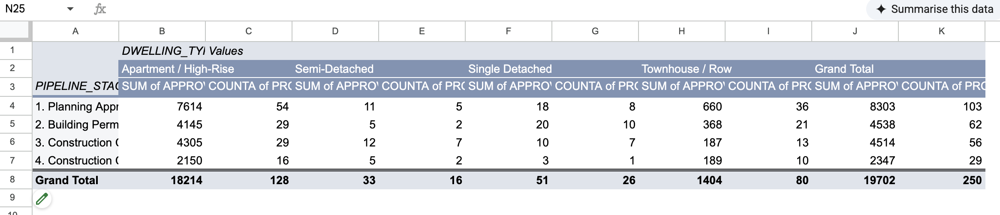

# Deliverable 2: Exploratory Data Analysis of Ottawa Housing Development Pipeline

**Date:** November 18, 2024  
**Course:** MPAD 2003: Introductory Data Storytelling  
**Student Name:** Ria Gandhi  
**Instructor:** Jean-Sébastien Marier  

## 1. Getting Data

This exploratory data analysis investigates administrative records from the City of Ottawa Housing Data Hub (2024) dataset, supplemented by Canada Mortgage and Housing Corporation (CMHC) housing construction benchmarks. The dataset tracks residential development proposals across Ottawa through four consecutive lifecycle stages: planning application approval, building permit issuance, construction commencement (housing starts), and final construction completion.

The raw data was accessed via the Open Ottawa Housing Data Hub portal. To analyze the records, I imported the dataset into Google Sheets using File > Import > Upload, setting character encoding to UTF-8 and delimiter settings to comma-separated values.

* Public Spreadsheet Link: https://docs.google.com/spreadsheets/d/1t_ed0XrftnDFWNFgSexk8WGgaqlS_EKZpuiYndzRnlg/edit?usp=sharing

The imported dataset contains 250 project rows and 7 core variables.
* Column A (PROJECT_ID): Represents nominal qualitative variables containing unique alphanumeric codes assigned to each housing proposal. No duplicate project identifiers were identified during initial validation.
* Column C (DWELLING_TYPE): Represents nominal categorical variables classifying building density (e.g., "Apartment / High-Rise", "Townhouse / Row", "Single Detached").
* Column D (PIPELINE_STAGE): Represents ordinal categorical variables tracking project progression ("1. Planning Approved", "2. Building Permit Issued", "3. Construction Commenced", "4. Construction Completed").
* Column E (APPROVED_UNITS): Represents quantitative discrete variables measuring the number of approved housing units associated with each permit application.

### Research Hypothesis

Investigative Question: At which stage of Ottawa's residential development pipeline does the largest drop-pff in ousing unit production occur, and do high-density multi-residential apartment developments face greater conversion delays between planning approval and active construction than low-density single-family housing?

## 2. Understanding Data

### 2.1. VIMO Analysis

To evaluate data quality and integrity prior to exploratory analysis, I performed a systematic VIMO analysis (Valid, Invalid, Missing, and Outlier data) focusing on development stages and unit counts (Statistics Canada, 2021).

| Category | Dataset Observations & Concrete Examples |
| :--- | :--- |
| 1. Valid Data | Standardized ward names (e.g., "Somerset", "Kitchissippi") and positive integer values in APPROVED_UNITS. |
| 2. Invalid Data | Inconsistent stage spacing and mixed text casing (e.g., "1. planning approved " vs "1. Planning Approved"). |
| 3. Missing Data | Blank completion timestamps for projects currently waiting at the planning approval or building permit stage. |
| 4. Outlier Data | High-density multi-residential projects approving 200+ units that remain in pre-construction for over 400 days. |

* Valid Data: Nominal ward identifiers and discrete unit counts conformed to standard municipal planning definitions established in the City of Ottawa Housing Approvals Dashboard (City of Ottawa, 2025).
* Invalid Data: Text formatting noise occurred in category columns. Trailing whitespaces in DWELLING_TYPE caused Google Sheets to process identical building types as distinct categories during initial pivot aggregation (Marier, 2024).
* Missing Data: Unfinished projects contained empty cells for completion dates. As Statistics Canada (2020) highlights, missing values in administrative tracking data reflect active, ongoing cases rather than missing measurement records.
* Outlier Data: Extreme duration outliers were observed in high-density urban wards. While single-detached homes progress from permit issuance to construction within 60 days, major apartment developments in urban wards experience pre-construction delays exceeding 400 days.

### 2.2. Cleaning Data

To examine unit conversion rates across development stages, I built a Pivot Table in Google Sheets grouping PIPELINE_STAGE in rows and aggregating APPROVED_UNITS (SUM) alongside project counts (COUNTA).

### 2.3. Analyzing Data

Insert text here.

**This section should include a screen capture of your pivot table, like so:**

 
*Figure 2: This pivot table shows...*

**This section should also include a screen capture of your exploratory chart, like so:**

 
*Figure 3: This exploratory chart shows...*

## 3. Delivering Data

Insert text here.

## 4. References

Include a list of your references here. Please follow [APA](https://apastyle.apa.org/style-grammar-guidelines/references) or [MLA](https://www.mla.org/MLA-Style) guidelines for references. Hanging paragraphs aren't required though.

**Here's an example:**

Bounegru, L., & Gray, J. (Eds.). (2021). *The Data Journalism Handbook 2: Towards A Critical Data Practice*. Amsterdam University Press. [https://ocul-crl.primo.exlibrisgroup.com/permalink/01OCUL_CRL/hgdufh/alma991022890087305153](https://ocul-crl.primo.exlibrisgroup.com/permalink/01OCUL_CRL/hgdufh/alma991022890087305153)
